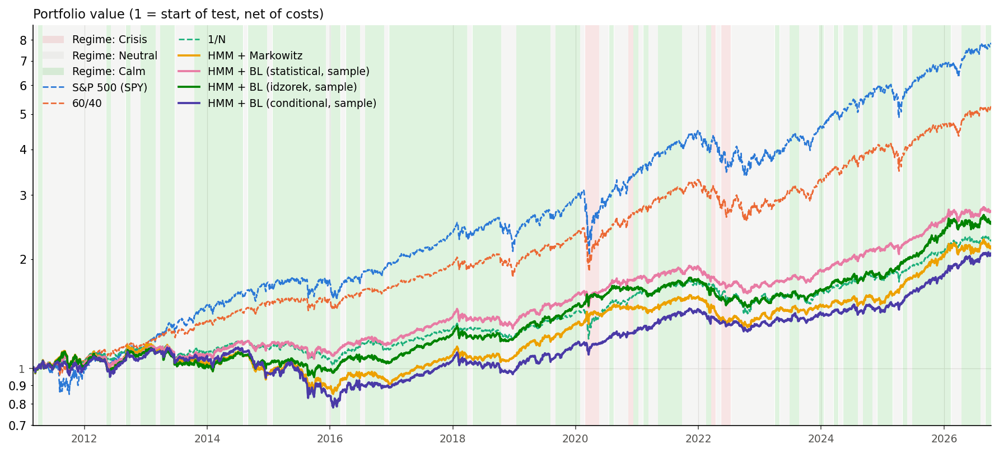
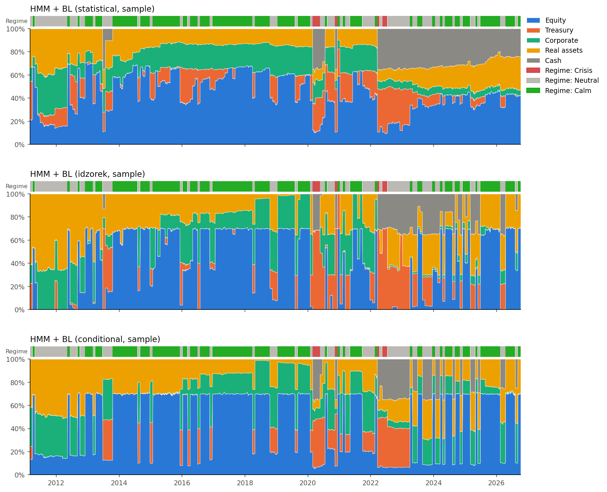
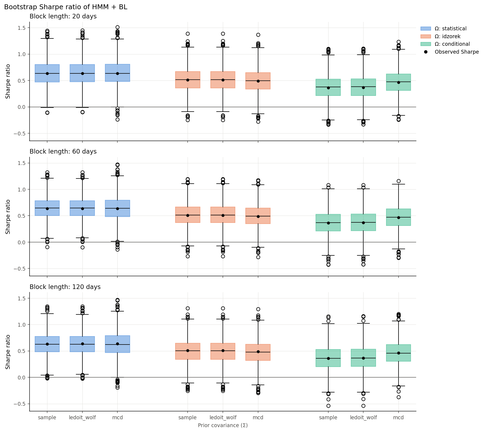
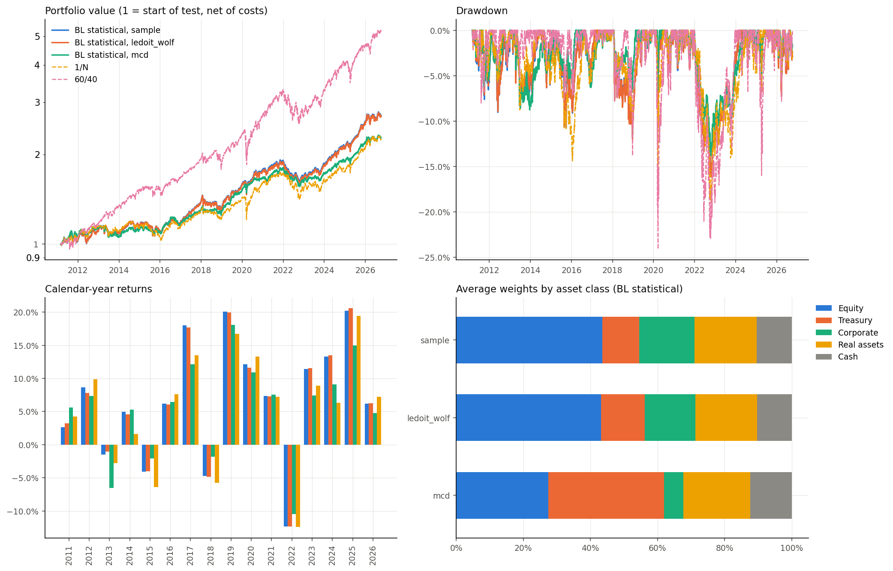
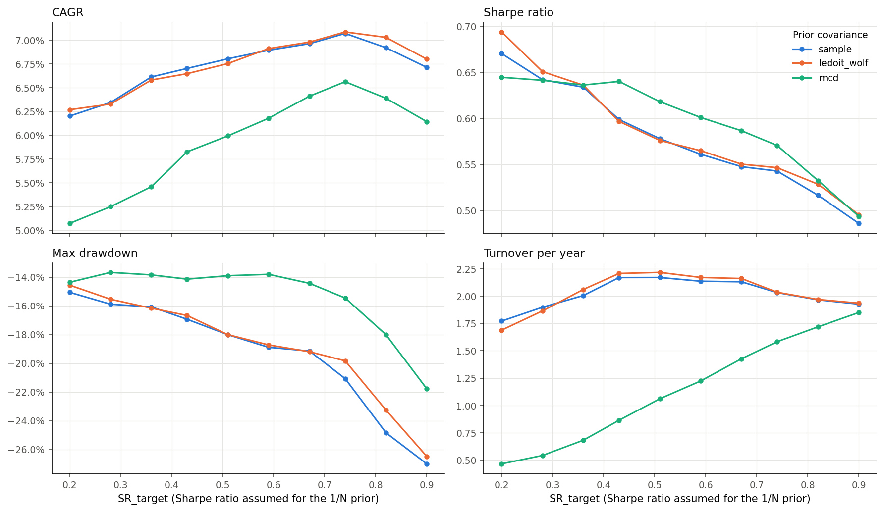
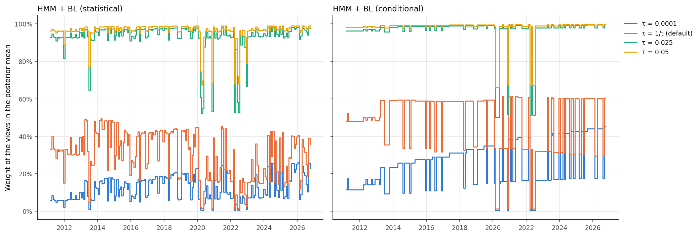
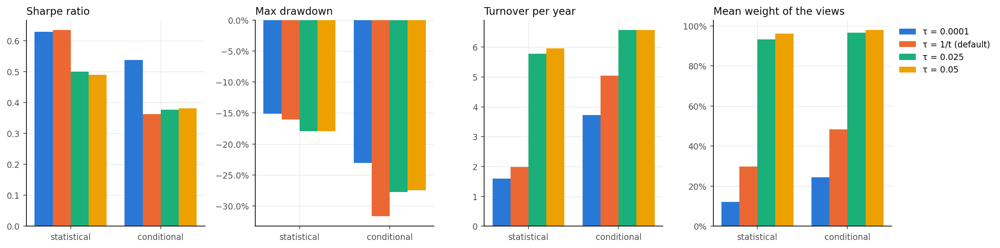

# Regime-aware Black-Litterman: HMM + Black-Litterman asset allocation

This work is a first exploratory analysis of asset allocation using a classical combination of a
Hidden Markov Model and the Black-Litterman model: the HMM identifies the market regimes and
provides the views, Black-Litterman combines them with an equilibrium prior. Three specifications of
the views (most likely regime, mixture of regimes, Idzorek) are combined with three estimators of
the covariance matrix of the prior: the sample covariance, Ledoit-Wolf shrinkage and the Minimum
Covariance Determinant. The resulting nine configurations are backtested walk-forward from 2011 to
2026, against passive benchmarks, and their Sharpe ratios are compared with a paired circular block
bootstrap, with Holm's correction for multiple comparisons.

We consider long-only portfolios with proportional transaction costs, built from 9 ETFs quoted in
USD:

- **SPY:** S&P 500 (US large caps)
- **EEM:** MSCI Emerging Markets
- **EFA:** MSCI EAFE (developed markets outside the US and Canada)
- **TLT:** US Treasuries, 20+ years
- **IEF:** US Treasuries, 7-10 years
- **TIP:** US inflation-protected Treasuries (TIPS)
- **LQD:** US investment-grade corporate bonds
- **GLD:** gold
- **DBC:** diversified commodities

A USD cash account is also available, which grows at the 13-week T-bill rate (`^IRX`).

---

## Notation

**Market**

- $N = 9$: number of risky assets (the ETFs above); cash is the $(N+1)$-th asset.
- $r_t \in \mathbb{R}^N$: daily log-returns of the risky assets on day $t$.
- $r_f$: daily risk-free rate (`^IRX`), the return of cash.
- $t$: number of days of history at the last refit of the models.
- $\Sigma_{\mathrm{long}}$: covariance of $r_t$ estimated on the whole history (sample, Ledoit-Wolf or
  Minimum Covariance Determinant, `prior_cov`).

**Hidden Markov Model** (variational Bayes, `hmmlearn`)

- $S_t \in \lbrace 1, \dots, K \rbrace$: market regime on day $t$, with $K = 3$ (crisis, neutral, calm,
  ordered by decreasing volatility). It is a Markov chain with transition matrix $A$.
- $\mu_k$, $\Sigma_k$: mean and covariance of returns in regime $k$, $r_t \mid S_t = k \sim \mathcal{N}(\mu_k, \Sigma_k)$.
- $\hat{\mu}_k$, $\hat{\Sigma}_k$, $\hat{A}$: estimates of $\mu_k$, $\Sigma_k$, $A$.
- $p_t = P(S_t \mid r_1, \dots, r_t)$: filtered regime probabilities.
- $p_{t+1} = p_t \hat{A}$: predicted probabilities of the next regime, $P(S_{t+1} \mid r_1, \dots, r_t)$.
- $N_k$: effective number of days spent in regime $k$, the sum over the history of the smoothed
  probabilities of regime $k$.

**Black-Litterman**

- $\mu \in \mathbb{R}^N$: expected returns of the risky assets, the unknown of the model.
- $w_{\mathrm{ref}} = \mathbf{1}/N$: reference portfolio of the prior.
- $SR_{\mathrm{target}}$: annual Sharpe ratio assumed for the reference portfolio (default 0.35).
- $\delta_{\mathrm{eq}}$, $\Pi$, $\tau$: risk aversion implied by $SR_{\mathrm{target}}$, equilibrium
  risk premium (reverse optimization) and scale of the prior uncertainty

```math
\delta_{\mathrm{eq}} = \frac{SR_{\mathrm{target}} / \sqrt{252}}{\sqrt{w_{\mathrm{ref}}^\top \Sigma_{\mathrm{long}} w_{\mathrm{ref}}}}, \qquad \Pi = \delta_{\mathrm{eq}} \Sigma_{\mathrm{long}} w_{\mathrm{ref}}, \qquad \tau = \frac{1}{t}
```

- $Q \in \mathbb{R}^N$, $\Omega \in \mathbb{R}^{N \times N}$: views on $\mu$ and their covariance. Views
  are absolute, one per asset ($P = I$).
- $\Sigma_t$: covariance of next-period returns given by the HMM.
- $\bar{\mu}$, $M$: posterior mean and covariance of $\mu$.
- $W = M \Omega^{-1}$: weight of the views in the posterior mean, which with $P = I$ can be written as
  $\bar{\mu} = (I - W)(r_f \mathbf{1} + \Pi) + W Q$. The prior gets the weight $I - W$.
- $\bar{\Sigma} = \Sigma_t + M$: covariance of next-period returns used by the optimizer.

**Portfolio**

- $w \in \mathbb{R}^{N+1}$: weights of the risky assets and cash.
- $w_{\mathrm{cur}}$: current weights, drifted with prices since the last rebalance.
- $H = 20$: days between rebalances.
- $\delta$: risk aversion of the investor.
- $\kappa = 10$ bps: proportional transaction cost per unit of turnover.

## Models

The three models share the prior and differ in the views ($Q$, $\Omega$) and in $\Sigma_t$. Each one
is a view equation and a prior on $\mu$

```math
\mu = Q + \varepsilon, \quad \varepsilon \sim \mathcal{N}(0, \Omega), \qquad\qquad \mu \sim \mathcal{N}(r_f \mathbf{1} + \Pi, \tau \Sigma_{\mathrm{long}})
```

**Model 1: most likely regime** (`omega="conditional"`), with $s = \arg\max_k p_k$

```math
Q = \hat{\mu}_s, \qquad \Omega = \frac{\hat{\Sigma}_s}{N_s}, \qquad \Sigma_t = \hat{\Sigma}_s
```

**Model 2: mixture of regimes** (`omega="statistical"`)

```math
\begin{aligned}
Q &= \sum_k p_k \hat{\mu}_k \\[4pt]
\Omega &= \sum_k p_k \frac{\hat{\Sigma}_k}{N_k} + \sum_k p_k (\hat{\mu}_k - Q)(\hat{\mu}_k - Q)^\top \\[4pt]
\Sigma_t &= \sum_k p_k \hat{\Sigma}_k + \sum_k p_k (\hat{\mu}_k - Q)(\hat{\mu}_k - Q)^\top
\end{aligned}
```

**Model 3: Idzorek** (`omega="idzorek"`), with confidence $c = 0.7$ in the views, and $Q$ and
$\Sigma_t$ as in model 2

```math
\Omega = \frac{\tau (1 - c)}{c} \Sigma_{\mathrm{long}}
```

**Posterior**, common to the three models

```math
\begin{aligned}
M &= \left[ (\tau \Sigma_{\mathrm{long}})^{-1} + \Omega^{-1} \right]^{-1} \\[4pt]
\bar{\mu} &= M \left[ (\tau \Sigma_{\mathrm{long}})^{-1} (r_f \mathbf{1} + \Pi) + \Omega^{-1} Q \right] \\[4pt]
\bar{\Sigma} &= \Sigma_t + M
\end{aligned}
```

## Portfolio optimization

At every rebalance the new weights solve

```math
\begin{aligned}
\max_{w} \quad & H \bar{\mu}^\top w - \frac{\delta}{2} H w^\top \bar{\Sigma} w - \kappa \lVert w - w_{\mathrm{cur}} \rVert_1 \\[4pt]
\text{subject to} \quad & \mathbf{1}^\top w = 1, \qquad 0 \le w_i \le 0.35, \qquad \sum_{i \in \mathrm{Equity}} w_i \le 0.70
\end{aligned}
```

where $\bar{\mu}$ and $\bar{\Sigma}$ are extended to cash with expected return $r_f$ and zero variance,
and the 35% cap applies to every asset, cash included. The benchmarks are SPY and 60/40 SPY/IEF
(buy-and-hold), 1/N (rebalanced) and HMM + Markowitz, which solves the same problem with
$(\hat{\mu}_s, \hat{\Sigma}_s)$ in place of $(\bar{\mu}, \bar{\Sigma})$.

## Metrics

Computed on the daily simple returns $R_t$ of the backtest, net of costs, over $Y$ years (number of
days / 252). The portfolio value is $W_t = \prod_{s \le t} (1 + R_s)$ and $q_{0.01}$ is the empirical
1% quantile of the daily returns.

```math
\begin{aligned}
\mathrm{CAGR} &= W_T^{1/Y} - 1 \\[4pt]
\mathrm{Vol} &= \sqrt{252} \, \mathrm{std}(R_t) \\[4pt]
\mathrm{Sharpe} &= \sqrt{252} \, \frac{\mathrm{mean}(R_t - r_{f,t})}{\mathrm{std}(R_t - r_{f,t})} \\[4pt]
\mathrm{MaxDD} &= \min_t \left( \frac{W_t}{\max_{s \le t} W_s} - 1 \right) \\[4pt]
\mathrm{Calmar} &= \frac{\mathrm{CAGR}}{|\mathrm{MaxDD}|} \\[4pt]
\mathrm{VaR}_{99\%} &= -q_{0.01} \\[4pt]
\mathrm{ES}_{99\%} &= -\mathrm{mean}(R_t \mid R_t \le q_{0.01}) \\[4pt]
\mathrm{Turnover/yr} &= \frac{1}{Y} \sum_{\mathrm{rebalances}} \lVert w_{\mathrm{new}} - w_{\mathrm{cur}} \rVert_1 \\[4pt]
\mathrm{Costs/yr} &= \kappa \cdot \mathrm{Turnover/yr}
\end{aligned}
```

VaR and ES are historical and computed on daily returns; costs are a fraction of wealth.

Differences in Sharpe ratio are tested with a paired circular block bootstrap (block lengths of 20,
60 and 120 days, 2000 replicates), with Holm correction for multiple comparisons.

## Results

This project is an exploratory analysis: rather than optimizing a single configuration, I study how
the results change when the main modeling choices are varied, namely the covariance of the views
$\Omega$, the estimator of $\Sigma_{\mathrm{long}}$, the Sharpe ratio $SR_{\mathrm{target}}$ that
calibrates the prior and the scale $\tau$ of the prior uncertainty. All parameters are fixed ex ante
and none of them is tuned on the backtest.

The test period goes from March 2011 to October 2026 (15.6 years); the first five years of data are
used only for estimation. Unless stated otherwise, the prior uses the sample covariance,
$SR_{\mathrm{target}} = 0.35$ and $\tau = 1/t$, and Idzorek's method uses $c = 0.7$. All results are
net of costs.

### Main results

| Strategy | CAGR | Vol | Sharpe | MaxDD | Turnover/yr |
|---|--:|--:|--:|--:|--:|
| S&P 500 (SPY) | 14.1% | 17.0% | 0.77 | −33.7% | 0.00 |
| 60/40 (SPY/IEF) | 11.2% | 12.1% | 0.81 | −24.1% | 0.00 |
| 1/N | 5.3% | 8.1% | 0.49 | −19.0% | 0.28 |
| HMM + Markowitz | 5.0% | 9.9% | 0.38 | −27.1% | 6.58 |
| BL, model 1 (conditional) | 4.7% | 9.6% | 0.36 | −31.7% | 5.04 |
| BL, model 2 (mixture) | 6.6% | 8.1% | 0.63 | −16.1% | 1.99 |
| BL, model 3 (Idzorek, c = 0.7) | 6.1% | 9.3% | 0.51 | −17.1% | 5.60 |

The mixture model (model 2) is the best Black-Litterman configuration. Compared with its reference
portfolio 1/N it has a higher Sharpe ratio (0.63 against 0.49), a higher CAGR (6.6% against 5.3%) and
a smaller maximum drawdown (−16.1% against −19.0%) at the same volatility. The passive 60/40 and SPY
portfolios remain clearly ahead in returns and Sharpe ratio (0.81 and 0.77): the test period is
dominated by the rally of US equities, which rewards portfolios concentrated in the S&P 500, while
the Black-Litterman portfolios are diversified across nine assets and hold at most 70% in equities.
On the other hand, the mixture and Idzorek models have a much smaller drawdown than the two
equity-heavy benchmarks.

The comparison with HMM + Markowitz isolates the contribution of Black-Litterman. With the same
regime model, plugging the regime estimates directly into the optimizer yields a Sharpe ratio of
0.38 and a turnover of 6.6 per year, while the mixture model reaches 0.63 with a turnover three times
lower: the prior shrinks the noisy regime estimates towards the equilibrium returns and stabilizes
the portfolio.



*Portfolio value (log scale, net of costs). The background shows the regime predicted by the HMM.*



*Weights by asset class of the three Black-Litterman models, with the regime predicted by the HMM.*

### Choice of Ω

The natural choice of $\Omega$ with views from the HMM is the mixture (model 2): by the law of total
variance it accounts for both the estimation error of the regime means and the uncertainty on the
next regime. Model 1 instead takes the most likely regime as if it were known. The two coincide when
the HMM is confident. When it is not, the mixture averages the mean of the most likely regime with
those of the other regimes, which in a bull market lowers the expected returns of the views, and it
inflates both $\Omega$ and $\Sigma_t$, so the portfolio becomes more defensive. My initial hypothesis
was therefore that in a mostly bullish period the mixture would give up part of the returns, while
the conditional model would trade more decisively on the regime signal and earn more at the cost of
higher risk.

The data do not support this hypothesis. The conditional model has a lower Sharpe ratio (0.36
against 0.63) and CAGR (4.7% against 6.6%), twice the drawdown (−31.7% against −16.1%) and 2.5 times
the turnover. The weights above show why: following the most likely regime, the conditional
portfolio jumps between extreme allocations, with equities at the 70% cap or close to zero, while the
mixture changes gradually. The extra confidence in the most likely regime is not rewarded: when the
regime signal is wrong or switches, the portfolio is fully exposed to the wrong view. Idzorek's
method lies in between (Sharpe 0.51): with $c = 0.7$ the views always receive 70% of the weight in
the posterior mean, against 30% on average for the mixture, which adapts the weight of the views to
their reliability (see the analysis of $\tau$ below).

The difference between the mixture and the conditional model is the largest one
($\Delta SR = 0.27$): taken in isolation, its 95% bootstrap interval excludes zero with blocks of 20
and 60 days (p-values 0.040, 0.048 and 0.057 for blocks of 20, 60 and 120 days). However, no pairwise
difference among the nine configurations is significant at 5% after Holm's correction for the 36
comparisons, for any block length, so the ranking should be read as indicative.



*Bootstrap distribution of the Sharpe ratio of the nine Black-Litterman configurations (paired
circular block bootstrap, 2000 replicates). Dots are the observed Sharpe ratios.*

### Covariance of the prior

Mixture model with the three estimators of $\Sigma_{\mathrm{long}}$; the last two columns are the
average weights of equities and Treasury bonds.

| Estimator | CAGR | Vol | Sharpe | MaxDD | Turnover/yr | Equities | Treasuries |
|---|--:|--:|--:|--:|--:|--:|--:|
| Sample | 6.6% | 8.1% | 0.63 | −16.1% | 1.99 | 43.5% | 11.0% |
| Ledoit-Wolf | 6.5% | 8.0% | 0.64 | −16.1% | 2.05 | 43.1% | 13.1% |
| MCD | 5.4% | 6.1% | 0.64 | −13.8% | 0.67 | 27.4% | 34.5% |

Since the prior is estimated on at least 1260 daily observations of nine assets, the optimal
Ledoit-Wolf shrinkage intensity is close to zero: its estimate, and the results, are almost identical
to those of the sample covariance. The Minimum Covariance Determinant (MCD), computed on the 95% most
central days, discards the most extreme observations and describes the covariance of normal market
conditions. It yields a more conservative portfolio, with on average 27% in equities and 35% in
Treasury bonds against 44% and 11% with the sample covariance. Volatility, drawdown and turnover are
lower, the CAGR is lower and the Sharpe ratio is the same: the MCD prior takes less risk, but not
better risk. Year by year it loses less in years of equity losses, such as 2018 and 2022, and gains
less during the equity rallies of 2017 and 2023-2025, while in 2013, the year of the taper tantrum,
its larger Treasury allocation is penalized. The extreme days discarded by the MCD are genuine risk
rather than measurement errors, but since crisis periods are modeled separately by the HMM, a prior
describing normal conditions is a defensible choice.



*Mixture model with the three covariance estimators of the prior, against 1/N and 60/40: portfolio
value, drawdown, calendar-year returns and average weights by asset class.*

### Sharpe ratio of the prior

$SR_{\mathrm{target}}$ calibrates $\delta_{\mathrm{eq}}$ and therefore scales linearly the equilibrium
risk premium

```math
\Pi = \frac{SR_{\mathrm{target}}}{\sqrt{252}} \frac{\Sigma_{\mathrm{long}} w_{\mathrm{ref}}}{\sigma_{\mathrm{ref}}}
```

where $\sigma_{\mathrm{ref}}$ is the daily volatility of the reference portfolio. Each component of
$\Sigma_{\mathrm{long}} w_{\mathrm{ref}} / \sigma_{\mathrm{ref}}$ is the marginal contribution of an
asset to the volatility of the 1/N portfolio, so a higher $SR_{\mathrm{target}}$ raises above all the
prior expected returns of equities and makes the portfolio more aggressive.

For the mixture model with the sample covariance, as $SR_{\mathrm{target}}$ goes from 0.2 to 0.9 the
volatility increases from 7.0% to 11.5% and the maximum drawdown deepens from −15.1% to −27.0%, while
the CAGR increases only up to $SR_{\mathrm{target}} \approx 0.75$ (7.1%) and then declines. The Sharpe
ratio decreases monotonically from 0.67 to 0.49: in a period dominated by an equity rally, a more
aggressive prior increases returns up to a point, but the additional risk is not rewarded
proportionally. For moderate values the MCD prior is less sensitive: its Sharpe ratio stays around
0.64 up to $SR_{\mathrm{target}} \approx 0.45$ and its drawdown around −14% up to 0.65, while for the
highest values the Sharpe ratios of the three estimators converge. Since $SR_{\mathrm{target}}$
cannot be identified from the data, it was fixed ex ante at 0.35, a plausible long-run Sharpe ratio
for a diversified portfolio, and this analysis is a robustness check rather than a way to select it.



*Mixture model: CAGR, Sharpe ratio, maximum drawdown and turnover as a function of SR_target, for
the three covariance estimators of the prior.*

### Scale of the prior uncertainty τ

The goal of this analysis is to check whether $\tau = 1/t$ is a good choice. With $\tau = 1/t$ the
prior is as precise as a sample mean over the $t$ days of history, so $\tau$ goes from about 0.0008
to 0.0002 over the test period. More generally, one can write $\tau = c/t$, where the constant $c$
expresses the confidence in the reference portfolio: with $c \lt 1$ the prior is tighter and gets more
weight, with $c \gt 1$ the views get more weight. I compare the default ($c = 1$) with a constant
$\tau = 0.0001$, which corresponds to $c$ between about 0.1 and 0.5 over the sample, and with the
values 0.025 and 0.05 that are common in the literature, which correspond to $c$ between about 30 and
260. The column "View weight" is the average over the rebalances of the mean diagonal of the matrix
$W = M \Omega^{-1}$ defined in the notation: 0% means that the posterior mean equals the prior, 100%
that it equals the views.

| Model | τ | c = τt | Sharpe | MaxDD | Turnover/yr | View weight |
|---|---|--:|--:|--:|--:|--:|
| Mixture (model 2) | 0.0001 | 0.1-0.5 | 0.63 | −15.2% | 1.59 | 12% |
| | 1/t (default) | 1 | 0.63 | −16.1% | 1.99 | 30% |
| | 0.025 | 30-130 | 0.50 | −17.9% | 5.78 | 93% |
| | 0.05 | 60-260 | 0.49 | −17.9% | 5.95 | 96% |
| Conditional (model 1) | 0.0001 | 0.1-0.5 | 0.54 | −23.0% | 3.72 | 25% |
| | 1/t (default) | 1 | 0.36 | −31.7% | 5.04 | 48% |
| | 0.025 | 30-130 | 0.38 | −27.8% | 6.57 | 97% |
| | 0.05 | 60-260 | 0.38 | −27.5% | 6.58 | 98% |

For the mixture model $\tau = 1/t$ is a good choice: a stronger prior ($c \lt 1$) leaves the results
practically unchanged (Sharpe 0.63, with a slightly lower turnover), while a much weaker one
($c \gg 1$) is harmful. With the values from the literature the views receive more than 90% of the
weight, because $\Omega$ measures the estimation error of the regime means, $\hat{\Sigma}_k / N_k$,
which is small with thousands of observations. The prior becomes almost irrelevant and
Black-Litterman behaves like a mean-variance optimizer on the HMM estimates: the turnover of the
mixture triples, close to that of HMM + Markowitz, and its Sharpe ratio falls to 0.49-0.50.

The conditional model, whose views ignore the uncertainty on the regime and are therefore
overconfident, benefits from a stronger prior: with $\tau = 0.0001$ its Sharpe ratio rises from 0.36
to 0.54 and its drawdown improves from −31.7% to −23.0%. Note that with a constant $\tau$ the weight
of the views is not constant: the prior does not tighten over time, while $\Omega$ shrinks as the
regimes accumulate observations, so the weight of the views grows over the sample (from about 10% to
45% in the conditional model).

In short, $\tau = 1/t$ is a good default, and if the data suggest a correction, it goes towards a
stronger prior rather than a weaker one, even though the 1/N reference portfolio is naive. The HMM
views are noisy and giving them more weight does not pay off: 1/N has no estimation error, which
makes it a hard benchmark to beat. As for
$SR_{\mathrm{target}}$, $c$ is not tuned on the backtest and the default remains $\tau = 1/t$.





*Mixture and conditional models with four values of τ. Top: weight of the views in the posterior
mean at each rebalance. Bottom: Sharpe ratio, maximum drawdown, turnover and average weight of the
views.*

### Statistical significance and limitations

- **One market history.** The block bootstrap measures the uncertainty due to the sequence of
  market returns, not the estimation risk of the models, and with 15.6 years of data it is large:
  the bootstrap standard deviation of the Sharpe ratio is about 0.22, and the 95% interval of the
  mixture model goes from about 0.2 to 1.1. No difference among the Black-Litterman configurations
  is significant after correcting for multiple comparisons; without correction, 12 of the 108 tests
  (36 pairs for three block lengths) fall below 5%, all of them involving the conditional model.
- **Benchmarks.** The comparison with the passive benchmarks and with HMM + Markowitz is
  descriptive, since these strategies are not included in the bootstrap tests.
- **Period.** The test period is dominated by a rally of US equities, which favors the 60/40 and SPY
  portfolios; a different period could change the ranking.
- **Regimes.** The regimes are ordered by volatility, not by returns, so they do not coincide with
  bull and bear markets by construction. In the test period the crisis regime is predicted only in a
  few short episodes, in 2020 and 2022.
- **Absolute views.** The views are absolute returns estimated on a history dominated by near-zero
  interest rates. When T-bill rates rose in 2022 the excess returns implied by the views decreased,
  which is a likely explanation of the large cash positions that the models hold from 2022 onwards,
  most persistently the mixture model. Expressing the views in excess of the risk-free rate would
  remove this effect.
- **Costs.** With turnovers between 0.7 and 6.6 per year, the active strategies pay between 0.07%
  and 0.66% per year in costs, a relevant difference for the more active configurations.
- **Data snooping.** Several analyses have been run on the same data. To limit this risk, all
  parameters were fixed ex ante and the sensitivity analyses are not used to select them.

### Future work: the HMM

No experiments have been done on the HMM itself: the number of regimes ($K = 3$), the refit frequency
and the Gaussian distribution of returns within each regime have been fixed. A natural extension is
to define the problem in a wider Bayesian framework and to use for each regime a non-Gaussian
distribution, such as a Student-t or a skewed distribution, to capture the fat tails and the
skewness of market returns. Some of these models can still be estimated with EM-type algorithms,
while a fully Bayesian treatment typically requires computationally intensive MCMC methods. Together
with a sensitivity analysis on $K$ and on the refit frequency, this is left for future work.

---

## Repository structure

```
regime-bl-portfolio/
├── main.py                 main backtest: benchmarks, HMM + Markowitz, 9 HMM + BL configurations
├── sr_sensitivity.py       sensitivity of HMM + BL to the prior Sharpe ratio (SR_target)
├── tau_sensitivity.py      sensitivity of HMM + BL to the scale τ of the prior uncertainty
├── cov_comparison.py       HMM + BL (statistical Ω) with the three covariance estimators
├── requirements.txt
├── data/                   cached input data (rets.csv, rf.csv)
├── figures/                generated plots
├── results/                generated tables (CSV)
└── regime_portfolio/
    ├── data.py             download and caching of returns and risk-free rate
    ├── regimes.py          RegimeModel: multivariate HMM (hmmlearn), multistart, regime ordering
    ├── base.py             PortfolioStrategy: walk-forward backtest, optimizer, metrics
    ├── strategies.py       FixedWeights, MarkowitzHMM, BlackLittermanHMM
    ├── constraints.py      optimizer constraints (max weight, group bounds)
    ├── bootstrap.py        paired block bootstrap and pairwise Sharpe tests
    └── plots.py            plotting functions
```

## Installation

Python 3.9 or later (tested with Python 3.13).

```bash
pip install -r requirements.txt
```

## Usage

Run the main backtest from the repository folder (or with the Run button of an IDE):

```bash
python main.py
```

It takes roughly 5-10 minutes, most of which is spent fitting the HMM. The sensitivity analysis on
the prior Sharpe ratio (30 backtests) takes roughly 10-15 minutes:

```bash
python sr_sensitivity.py
```

`tau_sensitivity.py` (BL statistical and conditional with four values of τ) and `cov_comparison.py`
(BL statistical with the three covariance estimators) take roughly 5-10 minutes each. Plots can be
redrawn from the saved CSV files without rerunning the backtests, with `replot_bootstrap()` in
`main.py` and `replot()` in `sr_sensitivity.py` and `tau_sensitivity.py`.

### Configuration

All settings are constants at the top of `main.py`:

| Constant | Default | Meaning |
|---|---|---|
| `COMMON["n_train"]` | 1260 | days of history before the first rebalance (5 years) |
| `COMMON["rebalance_every"]` | 20 | days between rebalances |
| `COMMON["risk_aversion"]` | 0.05 | $\delta$ in daily % units (= 5 with returns in decimals) |
| `COMMON["spread_bps"]` | 10 | proportional transaction cost $\kappa$, in basis points |
| `CONSTRAINTS` | max 35% per asset, equity ≤ 70% | extra constraints of the optimized strategies |
| `OMEGAS`, `PRIOR_COVS` | 3 + 3 options | Black-Litterman configurations to run |
| `MAIN_PRIOR` | `"sample"` | prior covariance used in the performance and weights plots |
| `SEED`, `N_RESTARTS` | 123, 5 | HMM random seed and number of starts at every fit |
| `BLOCKS`, `N_BOOT` | (20, 60, 120), 2000 | bootstrap block lengths (days) and replicates |

## Data

- **Prices:** daily adjusted prices of the 9 ETFs from Yahoo Finance via `yfinance`, from March 2006.
- **Risk-free rate:** 13-week T-bill (`^IRX`); the cash return of day $t$ uses the rate of day $t-1$.
- Data are downloaded once and cached in `data/`, so every run uses the same numbers.
  Delete the folder to download fresh data.

## Outputs

| File | Content |
|---|---|
| `figures/performance.png` | portfolio value of all strategies, background colored by the predicted regime |
| `results/metrics.csv` | metrics table of all strategies (also printed) |
| `figures/bl_weights.png` | weights of the BL portfolios by asset class, with the predicted regime |
| `figures/bootstrap_sharpe.png` | bootstrap distribution of the Sharpe ratio of the 9 BL configurations |
| `results/bootstrap_sharpe.csv`, `sharpe_observed.csv` | data of the bootstrap box plots |
| `results/bootstrap_pairs.csv` | pairwise Sharpe differences, confidence intervals and p-values |
| `figures/sr_sensitivity_*.png`, `results/sr_sensitivity_*.csv` | sensitivity to the prior Sharpe ratio |
| `figures/tau_sensitivity_*.png`, `results/tau_sensitivity_*.csv` | sensitivity to τ, with the weight of the views over time |
| `figures/cov_comparison.png` | BL statistical with the three covariance estimators: value, drawdown, yearly returns, weights |

## Backtest conventions

- **Walk-forward, no look-ahead:** every decision at day $t$ uses only data up to $t-1$. The HMM is
  refitted once a year on an expanding window; regime probabilities are updated at every rebalance.
- **Benchmarks:** S&P 500 (SPY) and 60/40 (SPY/IEF) are buy-and-hold; 1/N is rebalanced to equal
  weights every `rebalance_every` days.
- **Costs and drift:** between rebalances weights drift with prices; at each rebalance the
  proportional cost is charged on the turnover $\lVert w_{\mathrm{new}} - w_{\mathrm{cur}} \rVert_1$.
- **Shared regime model:** all HMM strategies share one `RegimeModel`, which is fitted once and
  cached. Strategies sharing it must use the same calendar; the code raises an error otherwise.
- **Multistart:** at every refit the HMM is estimated from 5 starting points (including a warm start
  from the previous fit) and the fit with the highest ELBO is kept. The prior on the regime means is
  set to zero so that the ELBOs of the candidates are comparable.

## AI assistance

Developed with the assistance of AI tools (Claude) for coding and literature discussion; research
design, methodological choices and analysis of results are my own.

## References

- Black, F. & Litterman, R. (1992). *Global Portfolio Optimization*. Financial Analysts Journal, 48(5), 28-43.
- He, G. & Litterman, R. (2002). *The Intuition Behind Black-Litterman Model Portfolios*. Goldman Sachs.

